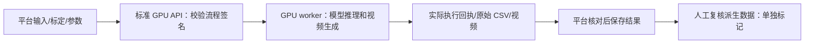

# TrackNet 默认与 GPU 执行一致性（2026-10-26）

适用范围：当前本机评测平台与本机标准羽毛球 GPU 服务。远程 GPU 保持关闭，本次没有连接或部署远程。

## 默认及标准入口

- 羽毛球任务模板、平台整段/流式任务准备、GPU 整段接口、底层主流程默认均为 `tracknet_v3`；优化运行时默认 `lightweight`。YOLO 和关闭检测保留为显式对照/选项。
- GPU 标准应用：`apps.badminton_gpu.app:app`；本机启动：在 `Good-Badminton-Local` 运行 `.venv/bin/python tools/run_local_gpu.py`，默认读取 `.secrets/gpu-api.env`。
- 平台标准应用：`evaluation_service.api:app`；以 README 的 uvicorn 命令和 `.secrets/evaluation.local.env` 启动，不再依赖历史任务启动脚本注入配置。
- 当前平台明确连接本机 8082。未设置 GPU 地址时拒绝创建客户端，避免默认连到 8080 的其他服务。
- 默认和模型路径由 `badminton_analysis/inference_policy.py` 集中解析。整段与流式共用 TrackNet 权重和人体权重；冲突的 TrackNet 路径/设备别名直接报错。配置文件已持久保存，已有凭据未改变，并留有私密备份。

## 请求到结果的校验

1. 平台核对 GPU 宣告支持的运动、代码及模型指纹，并读取对应接口的执行流程签名。TrackNet 原始流程必须为优化运行时，且人体/球权重可用。
2. 请求携带期望签名，GPU 在创建任务前核对；不符返回 HTTP 409。GPU 整段 worker 在执行前后再次检查流程未变化。
3. 整段 GPU 保存执行回执，包含实际选项、输入视频哈希、模板哈希、场地角点、代码/模型版本和实际流程。优化引擎另外保存权重/原始 CSV 哈希与插值策略。
4. 平台核对接收回执、实际检测器、完整参数、输入/模板/角点、实际权重与原始 CSV 哈希；校验失败不保存成功结果。成功写入 `gpu_execution_parity.json`，复核页显示已核验。
5. 流式请求与终态均核对独立流程签名；上传实际编码帧的序号、数量和真实 PTS，保持跨片窗口连续。
6. 视频和全帧实测统计直接来自 GPU；球路复核图、触球候选及其插值是平台派生数据，界面已明确来源，不冒充 GPU 原始观测或自动球型分类。

## 本次发现并修复

- GPU 接口及底层仍保留 YOLO 默认值，TrackNet 优化运行时依赖临时启动脚本。
- 整段/流式模型路径分开，流式人体权重仍指向 `/opt/...` 模板路径，真实短片触发 FileNotFoundError。现已共用本机权重，并将人体权重哈希纳入流程签名。
- 导入 GPU 工厂时额外创建隐藏服务实例。现改为按需创建，固定运动启动器不再隐式初始化第二组 worker。
- 流式评测未上传帧身份/真实时间，可能在片边界重置窗口。现由 ffprobe 读取实际 PTS 并上传。
- 强制关键帧的时间舍入会错过切片边界。增加 50 ms 分片容差，3 秒短片已实际切为两片，有真实 H.264 回归。
- 本机沿用了 10 秒分片处理时限，并缺少服务退出码 75 的监督重启。现本机设为 120 秒，启动器正确监督退出码 75，停止父进程也会停止 worker；其他错误退出不无限重试。

## 实际验证

- 完整原视频：`run-c2bac6b9769e4f2aba5883a48f22c327`，提交时省略球检测器，实际为优化 TrackNet；端到端一致性校验通过。原始 CSV 与上一版优化 TrackNet 结果逐字节一致，实测 1098 / 1473 帧。第 2 版标定与 1 秒淡出尾迹保留。
- [完整视频平台结果](http://127.0.0.1:3100/review?run_id=run-c2bac6b9769e4f2aba5883a48f22c327)。
- 流式短片：`run-71fd128784324f1e90e89a8553497765`，2 个上传片段、88 个编码帧，源帧序号 7–87 连续输出 81 条观测；跨片异常重置 0 次。
- 流式实际采样率、人体输入尺寸、跟踪器、远场增强、发现窗口及场地角点与请求一致；实际球观测权重哈希与 GPU 公布值一致。
- 不匹配流程的真实 HTTP 请求被拒绝，状态码 409。相关 GPU、平台、HTTP、分片和监督重启回归通过；TypeScript、ESLint、网络边界及私密配置检查通过。
- 前两次真实流式失败分别暴露模板模型路径和过短时限；保留失败记录，最终通过结果单独保存。遗留的超时测试会话已取消。

## 口径与限制

整段与流式共用优化模型，但时序算法不同，必须保持独立签名：整段使用 8 帧非重叠块、全片均匀背景采样；流式使用 8 帧滑窗、步长 1、首窗背景，前 7 帧预热不输出观测。流式兼容编码可能改变帧数，上传帧身份属于实际编码帧，不冒充原 DAV 采集帧。不能把两个流程的覆盖率直接作为同一召回率比较。

本次“一致”指平台请求与其对应的 GPU 实际执行一致，不宣称两个不同接口的算法互相等价，也不代表远端部署、实时吞吐或检测准确率已经验证。缺少逐帧人工真值时，覆盖率不等同于召回率。

机器证据：`/Users/sonny/Documents/codeBase/ai coach/outputs/gpu-parity-20261026/verification.json`、`/Users/sonny/Documents/codeBase/ai coach/outputs/gpu-parity-20261026/stream-verification.json`、`/Users/sonny/Documents/codeBase/ai coach/outputs/gpu-parity-20261026/gpu-health.json`。核验脚本：`verify_live.py`、`verify_stream.py`。

最新整段视频已完整解码核验，输出 1473 帧。浏览器控制关闭，本次未执行网页视觉或实际播放交互复核。
## 2026-10-27：降低远端球员身份恢复门槛

当前本机球检测走廊按用户要求为每侧近端场宽的 **20%**（250.9 px），本次只调整人物关联。优化 TrackNet 权重、人体权重、第 2 版标定、输入视频与球选择规则保持相同。

共享 `tracking/association_policy.py` 的 `person_association.v2` 同时供整段 FixedCameraMatchPipeline 和流式 PersonOnlyTracker 使用，实际参数及实现摘要进入各自 GPU 流程签名和 roster 证据。羽毛球新默认：

| 参数 | 调整前 | 调整后 |
| --- | --- | --- |
| ByteTrack 最大匹配代价 | 0.50 | 0.70 |
| 恢复所需人体置信度 | 0.65 | 0.50 |
| 恢复所需位置置信度 | 0.65 | 0.45 |
| 已关联队友的人体 / 位置置信度 | 0.70 / 0.70 | 0.55 / 0.50 |
| 已关联队友的身份置信度 | 0.80 | 0.75 |

Ultralytics 的分数融合代价为 `1 - IoU * detection_score`，所以提高最大代价才是放宽匹配。新纳入的弱观测仍需同半场、距预测位置最多 1.5 m；多候选时保留 0.35 m 的槽位距离差和 0.50 m 的双人总匹配代价差，不足则保留未分配。锁定 ByteTrack 名单还检查同编号的实测位移：最大速度由 tracker 的 10 m/s 默认值控制，另容许 0.35 m 定位偏差、最小门宽 0.8 m。编号重绑定只能有一位当前所有者，防止框交叠时身份跨网跳变。旧检查点缺少或不匹配人物策略时拒绝恢复。网球关联门槛保持原值。

同源视频 `20261024_192428.dav`（1565 源帧）的本地完整复跑：

- 基线 `run-e02d6cf5e9df4f6b87de6e3c62dd3067` → 最终 `run-f5e5c16a365a4816aa7f562956b10a64`。
- 远端未分配观测总数 224 → 131，减少 41.5%；涉及的 10 Hz 采样时刻 152 → 119。新版更早锁定名单，统计了额外的初始采样；共同的 516 个名单锁定采样时刻中，未分配观测为 224 → 123。
- 共同采样时段远端两人实测关联覆盖率为 787/1032（76.3%）→ 888/1032（86.0%）。这只是观测关联覆盖，不是身份正确率，也不是人工标注的检测召回率。部分未分配框与已分配球员重复，不能把全部未分配次数解释为漏人。
- 此前源帧 55（1.856786 s）的远端黑衣球员由未分配改为当前实测关联。12 个时刻的离线图像抽查包含约 48 s 的原串号位置；最终样本中远端黑衣为 track_001、白衣为 track_002。尚未做逐帧身份真值评测，不宣称全片零串号。
- 首轮 `run-abba31b261224d0baf3d97572a1ce8d3` 的后段抽查发现跨网身份跳变，加入位移与编号所有权检查后另建最终运行；保留首轮结果作诊断，不推荐作为最终结果。
- 最终原始球 CSV 与基线逐字节一致，仍为 1038/1565 接纳球点（66.3%可用率）；完整结果视频解码、GPU 执行一致性、产物哈希及四人运动报告核验通过。正常打球统计沿用同源视频的暂定视觉复核区间，共 24.8 s，不将其当作独立人工真值。
- 118 项相关 GPU 回归、13 项平台回归、两仓私密配置检查通过。登录密码哈希和长期服务密钥保持原值；未访问远端 GPU。

机器证据位于工作区 `outputs/far-player-thresholds-20261027/`：`player-comparison.json`、`final-verification.json`、`gpu-health.json`、`far-player-contact-sheet.jpg`。浏览器控制仍关闭，未完成网页交互式播放检查。

球体约束与触球准确率迭代现暂停，完整实现和实验记录保存在 `feat/shuttle-accuracy-iteration`。当前工作区保留既有优化 TrackNet 默认值、模型解析、执行签名及人物关联，不启用本轮球体筛选/触球实验。
